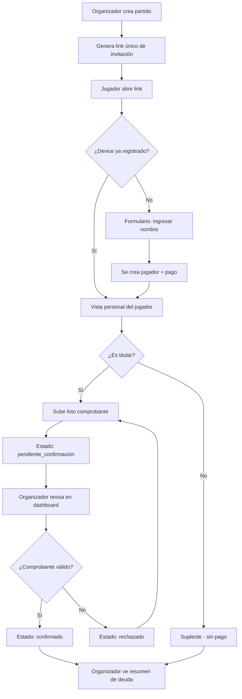
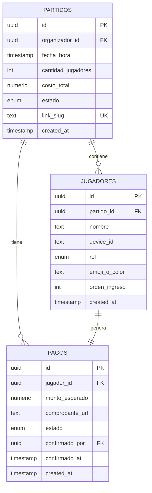

# appFut ⚽

> Organiza partidos de fútbol amateur entre amigos con gestión de pagos por comprobante.

**El problema:** Un grupo de amigos organiza partidos de fútbol (5vs5, 6vs6, etc.) y necesita coordinar quién juega y quién pagó su parte de la cancha, sin fricción de registro para los jugadores invitados.

---

## Diagrama de flujo



## Diagrama Entidad-Relación



---

## Decisiones de diseño clave

### 1. Los jugadores no necesitan cuenta

Los jugadores invitados **no tienen usuario ni contraseña**. Se identifican mediante un `device_id` (UUID v4 generado con `crypto.randomUUID()`) que se persiste en `localStorage`. Esto elimina la barrera de registro: abrir un link, poner el nombre y ya estás adentro.

### 2. Identificación por device_id

Cada dispositivo que accede a un partido guarda:
- `appfut_device_id`: UUID único del dispositivo (global para toda la app).
- `appfut_partido_{id}_jugador_id`: Relación entre el partido y el jugador concreto.

Si un jugador abre el link desde otro dispositivo (nuevo teléfono, PC), el sistema detecta que el `device_id` no coincide con ningún jugador existente y le muestra la lista de jugadores para que se identifique tocando su nombre, vinculando el nuevo dispositivo a su perfil existente.

### 3. Confirmación de pago exclusiva del organizador

El botón de "marcar como pagado" que aprieta un jugador **solo cambia el estado a "pendiente_confirmación"**. La única autoridad para pasar un pago a "confirmado" es el organizador autenticado.

Esto es una decisión de seguridad intencional: como cualquiera podría tocar el link desde cualquier dispositivo, el sistema **no depende de la honestidad del jugador** sino de la validación manual del organizador, que revisa la foto del comprobante y confirma o rechaza.

### 4. Roles y rotación automática

Los primeros N jugadores en unirse son titulares; los siguientes son suplentes. Si un titular se da de baja, el primer suplente en orden de ingreso pasa automáticamente a titular vía un trigger en la base de datos. El monto esperado se recalcula automáticamente.

---

## Stack técnico

| Capa | Tecnología |
|------|-----------|
| Frontend | Next.js 16 (App Router) + TypeScript |
| Estilos | Tailwind CSS 4 (Paleta "Césped nocturno") |
| PWA | next-pwa (manifest.json + service worker) |
| Backend/DB | Supabase (Postgres + Auth + Storage + RLS) |
| Autenticación | Supabase Auth (Google OAuth, solo organizador) |
| Hosting | Vercel |

## Requisitos previos

- Node.js 18+
- Una cuenta en [Supabase](https://supabase.com) (plan free)
- Una cuenta en [Vercel](https://vercel.com) (opcional, para deploy)

## Configuración local

1. Clonar el repositorio e instalar dependencias:

```bash
cd appFut
npm install
```

2. Copiar el archivo de variables de entorno:

```bash
cp .env.local.example .env.local
```

3. Completar las variables en `.env.local`:

```
NEXT_PUBLIC_SUPABASE_URL=https://tu-proyecto.supabase.co
NEXT_PUBLIC_SUPABASE_ANON_KEY=tu-anon-key
```

### Configuración de Supabase

1. Crear un proyecto en [Supabase](https://supabase.com).
2. Ir a **SQL Editor** y ejecutar el contenido de `supabase/migrations/00001_schema.sql`.
3. Ir a **Authentication → Providers** y habilitar **Google** (configurar OAuth con credenciales de Google Cloud Console).
4. Ir a **Storage** y crear un bucket llamado `comprobantes` con políticas públicas de lectura (y acceso autenticado para escritura).
5. En **Authentication → Settings**, configurar la URL del sitio como `http://localhost:3000` para desarrollo.
6. Copiar las credenciales (`Project URL` y `anon key`) de **Project Settings → API** a tu `.env.local`.

### Iniciar desarrollo

```bash
npm run dev
```

Visitar [http://localhost:3000](http://localhost:3000).

### Build de producción

```bash
npm run build
npm start
```

---

## Estructura del proyecto

```
src/
├── app/
│   ├── layout.tsx              # Layout raíz con metadata PWA
│   ├── page.tsx                # Landing page
│   ├── globals.css             # Estilos globales + tema
│   ├── middleware.ts           # Supabase session middleware
│   ├── auth/
│   │   ├── login/page.tsx      # Login con Google
│   │   └── callback/route.ts   # Callback OAuth
│   ├── organizador/
│   │   ├── page.tsx            # Dashboard: lista de partidos
│   │   ├── nuevo/page.tsx      # Crear nuevo partido
│   │   └── [id]/page.tsx       # Detalle: gestionar jugadores y pagos
│   ├── unirse/[slug]/page.tsx  # Join por link de invitación
│   └── p/[slug]/page.tsx       # Vista personal del jugador
├── components/
│   ├── ui/                     # Componentes reutilizables
│   └── partido/                # Componentes específicos de partido
├── lib/
│   ├── supabase/
│   │   ├── client.ts           # Cliente browser
│   │   ├── server.ts           # Cliente server
│   │   └── middleware.ts       # Utilidad middleware
│   ├── db/types.ts             # Tipos TypeScript del modelo
│   └── device.ts               # Utilidades de device_id
supabase/
└── migrations/
    └── 00001_schema.sql        # Esquema completo de BD
public/
├── manifest.json               # PWA manifest
└── icons/                      # Iconos de la app
```

---

## Licencia

MIT
# appFut
